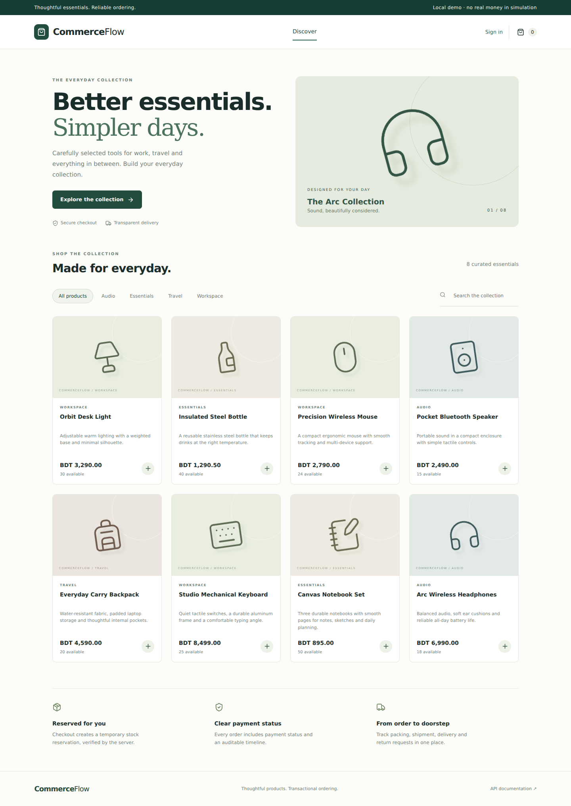

# CommerceFlow — E-Commerce Ordering & Fulfillment

A full-stack commerce application built around the difficult parts of ordering: concurrent stock reservations, immutable pricing snapshots, payment replay, expiring orders, fulfillment, returns and refund obligations.

CommerceFlow upgrades the original ordering/payment backend into a customer storefront and an operations workspace. The business rules are backed by PostgreSQL transactions, constraints, an inventory ledger and a durable outbox.

> **Payment scope:** Local simulation works without merchant credentials. Stripe test-mode Checkout and bKash sandbox adapters are included and disabled by default. Contract checks use mocks; merchant end-to-end acceptance is not verified. External refunds are processed in the merchant portal and recorded by an administrator. Local simulation never transfers money.



## Stack

| Layer           | Technology                                                                           |
| --------------- | ------------------------------------------------------------------------------------ |
| API             | NestJS 12, TypeScript, Node.js 24                                                    |
| Frontend        | React 19, TypeScript, Vite 8                                                         |
| Data            | PostgreSQL 18, Prisma 7 catalog queries, parameterized SQL for transaction hot paths |
| Background jobs | Redis 7.4, BullMQ, PostgreSQL outbox                                                 |
| Security        | Salted scrypt passwords, opaque cookie sessions, CSRF, role checks, rate limiting    |
| Tests           | Node Test Runner, Supertest, Vitest, Testing Library, optional Playwright            |
| Delivery        | Docker Compose, Nginx, GitHub Actions                                                |

Prisma and the SQL transaction layer share the same PostgreSQL connection pool. SQL migrations are authoritative; Prisma models expose catalog data, while explicit SQL makes lock order and inventory updates visible.

## Features

### Customer storefront

- Searchable, category-filtered catalog with server-side pagination.
- Shopping bag with delivery details and coupon entry.
- Atomic multi-product checkout with bounded quantities and idempotent retries.
- Server-calculated prices, integer paisa amounts, immutable item snapshots and transparent shipping rules.
- Expiring unpaid orders, simulation success/decline and provider checkout when configured.
- Order history, payment verification, tracking, audit timelines and in-app notifications.
- Cancellation before shipment and full-order return requests within 14 days of delivery.

### Operations workspace

- ADMIN product creation, activation/deactivation and version-checked price edits.
- Idempotent stock receiving with an append-only inventory movement ledger.
- Limited-use percentage coupons with minimum subtotal and expiry.
- STAFF/ADMIN fulfillment: paid → packed → shipped → delivered.
- Required shipment tracking and rejection of invalid stage changes.
- ADMIN approval/rejection of returns; approved received returns restock inventory once.
- Refund obligations, manual merchant refund completion records, worker heartbeat and job retries.

### Transaction and recovery safeguards

- Products are locked in deterministic UUID order during inventory mutations.
- `reserved <= on_hand` is enforced by database constraints.
- Checkout reserves stock; confirmed payment reduces both on-hand and reserved quantities.
- Expiry/cancellation releases pending reservations; paid cancellation/approved return restores stock.
- Duplicate success events do not consume stock twice.
- Payment amount, currency, provider and identity are verified before settlement.
- Payment confirmation claims an eligible order using a conditional database update and the database clock.
- Late successful payments create a refund obligation rather than reviving inventory ownership.
- Outbox delivery is at least once; notification and refund effects are idempotent in PostgreSQL.
- Provider initialization cannot regress an already settled payment.
- Provider timeouts remain uncertain rather than being treated as definitive payment failures.

## Quick Start

### Requirements

- Docker Desktop running with Linux containers.
- Docker Compose.
- A local Node.js installation for the configuration script.

Open VS Code in the extracted project root—the folder containing `docker-compose.yml`, `backend/` and `frontend/`—and run these commands in Git Bash:

```bash
node.exe scripts/setup-env.cjs
docker.exe compose up --build -d
docker.exe compose --profile tools run --rm seed
docker.exe compose ps -a
```

Open **http://localhost:3002**. API documentation: **http://localhost:3002/api/docs**.

The setup script creates unique local secrets and preserves an existing `.env`. Open `notepad.exe .env` locally to view `DEMO_PASSWORD`.

| Account           | Email                         | Password                      |
| ----------------- | ----------------------------- | ----------------------------- |
| Customer          | customer@commerceflow.example | Root `.env` → `DEMO_PASSWORD` |
| Fulfillment staff | staff@commerceflow.example    | Same demo password            |
| Administrator     | admin@commerceflow.example    | Same demo password            |

Seed only a fresh database. Seeding refuses to overwrite existing users. An exited `migrate` container with code `0` is expected.

**Manual setup without local Node:** copy `.env.example` to `.env` and replace password/secret placeholders. Use a demo password of 12–128 characters and a webhook secret of at least 32 characters. Single-quote values containing dotenv/Compose special characters. Separate PostgreSQL fields avoid URL password encoding.

## Upgrading the Original Project

This is a **version 2 schema and API redesign**, not an in-place migration of the uploaded version 1 database. Keep the old source/database as a backup. Do not copy its database volume into this application.

The Compose project is `commerceflow` and uses its own volumes. Port `3002` avoids the SeatFlow/Incident Dashboard port `3000`. PostgreSQL and Redis are internal; only `127.0.0.1:3002` is exposed.

Replace repository files with this package to publish the upgrade. Keeping the existing GitHub repository preserves its URL and history; deleting the repository is unnecessary. Do not copy a nested `.git` directory from another project.

For subsequent CommerceFlow updates, preserve the current `.env`, rebuild, and skip seeding:

```bash
docker.exe compose up --build -d --force-recreate
```

Never use `down -v` when preserving database contents.

## Demo Walkthrough

1. Sign in as the customer and add products to the bag.
2. Enter a delivery address. Try `WELCOME10` on a subtotal of at least BDT 1,000.
3. Reserve the order. Review the server-calculated discount, shipping and hold deadline.
4. Simulate a decline, then a successful payment while the order remains eligible.
5. Sign in as staff, open Operations and advance the order through packing, shipment and delivery.
6. Sign in as the customer and request a return for the delivered order.
7. Sign in as admin and approve the return **after physically receiving restockable items**.
8. Inspect inventory movements, the refund record and order timeline. The worker completes simulated refunds and delivers notifications.

A different customer cannot read, cancel or pay another customer's order. Staff can fulfill orders but cannot change inventory, coupons, returns or refund records.

### Pricing and policy rules

- Currency: BDT. All amounts are integer paisa (`100 paisa = BDT 1`).
- Shipping: BDT 49.90; free when discounted merchandise reaches BDT 2,500.
- Coupons: percentage discount rounded down to paisa; usage is consumed at reservation and is not restored after cancellation or expiry.
- Maximum 20 distinct products, quantity 1–10 per product, and five active unpaid orders per customer.
- Cancellation is allowed only while pending, paid or packed.
- Returns cover the full order and must be requested within 14 days of delivery.
- Taxes, partial shipments, partial returns and carrier integrations are not implemented.

## Payment Providers

Providers are disabled by default. Configure values in the root `.env` and recreate containers after changing them.

### Stripe test Checkout

```dotenv
STRIPE_ENABLED=true
STRIPE_SECRET_KEY=sk_test_your_key
STRIPE_WEBHOOK_SECRET=whsec_your_webhook_secret
PAYMENT_CALLBACK_ORIGIN=https://your-public-test-host.example
```

Expose `/api/payments/stripe/webhook` over HTTPS. Raw webhook signatures are verified by the Stripe SDK. Successful notifications trigger independent Checkout Session retrieval and identity/amount/currency verification.

Checkout creation uses a stable provider idempotency key. Only `sk_test_` keys are accepted; live Stripe mode is deliberately outside this demo.

### bKash sandbox

```dotenv
BKASH_ENABLED=true
BKASH_USERNAME=your_sandbox_username
BKASH_PASSWORD=your_sandbox_password
BKASH_APP_KEY=your_sandbox_app_key
BKASH_APP_SECRET=your_sandbox_app_secret
PAYMENT_CALLBACK_ORIGIN=https://your-public-test-host.example
```

The callback is `/api/payments/bkash/return`. Provider responses are queried and verified independently; callback query parameters do not establish payment success.

An uncertain bKash checkout creation is not automatically repeated because that could create another payable session. Merchant investigation is required when no remote identifier was received.

For either provider, configure `APP_ORIGIN` consistently with the frontend's public origin. Confirm the merchant API contract and complete sandbox acceptance before using externally hosted checkout.

### Refunds

Simulated refunds are worker-managed. External refund jobs notify the customer of the obligation, but never mark the refund completed automatically.

An administrator can record a refund **already executed in the merchant portal**, including a reference and audit entry. This action records an operator assertion; it does not independently verify or execute a bank transfer.

## Testing

### Backend Docker suite

```bash
docker.exe compose -f docker-compose.test.yml up --abort-on-container-exit --exit-code-from tests
docker.exe compose -f docker-compose.test.yml down
```

Tests use a separate `commerceflow_test` database. The reset guard refuses a database whose name does not end in `_test`.

The suite includes:

- Unit and mocked provider contract/security tests.
- Authorization, ownership, CSRF, validation and pagination.
- Reservation idempotency, multi-product rollback and price snapshots.
- Native last-unit contention and concurrent idempotent retries.
- Signed webhook verification, replay and late-payment compensation.
- Fulfillment, return-window enforcement and inventory reconciliation.
- Stock receiving, stale price edits, outbox delivery and session revocation.

**Verification scope:** Delivery checks passed 12 unit/provider tests, 20 functional integration scenarios against a single-connection PGlite PostgreSQL adapter with real Redis/BullMQ, and four frontend tests. A browser walkthrough also exercised payment, fulfillment and approved returns on desktop/mobile. The two native concurrency tests were skipped in that environment and must run on Docker/CI. See [Validation](docs/VALIDATION.md).

### Frontend

```bash
cd frontend
npm ci --ignore-scripts
npm test
npm run build
```

### Optional browser suite

With the seeded local stack running, open PowerShell in `frontend`:

```powershell
npm ci --ignore-scripts
npx playwright install chromium
$env:E2E_DEMO_PASSWORD = Read-Host "Local demo password"
npm run test:e2e
Remove-Item Env:E2E_DEMO_PASSWORD
```

The browser test creates and cancels an order; use disposable demo data. Browser binaries are excluded from the package.

## Continuous Integration

GitHub Actions runs backend compilation, unit/provider tests, native PostgreSQL/Redis integration tests, frontend tests and the frontend production build on pushes and pull requests.

Check the Actions tab after uploading. A supplied workflow is not evidence that CI has already run successfully. Browser tests are optional and outside the default workflow.

## Native Development

Use Node.js 24.15 or later. Configure reachable PostgreSQL and Redis services using `backend/.env.example`.

```bash
cd backend
npm ci --ignore-scripts
npm run generate
npm run build
npm run migrate
npm run seed
npm start
```

Run `npm run worker` in another backend terminal. Start the frontend with `npm start` from its directory. The frontend development proxy targets port `5002`.

`npm run dev` rebuilds once and watches compiled output; rebuild after TypeScript edits. SQL migrations are authoritative: do not use Prisma `db push` or `migrate dev` to replace the full schema.

## Project Structure

| Path                       | Responsibility                                               |
| -------------------------- | ------------------------------------------------------------ |
| `backend/src/auth.ts`      | Authentication, sessions and authorization                   |
| `backend/src/commerce.ts`  | Orders, inventory, fulfillment, returns and operations       |
| `backend/src/payments.ts`  | Checkout orchestration and reconciliation                    |
| `backend/src/providers.ts` | Stripe test and bKash sandbox adapters                       |
| `backend/src/worker.ts`    | Outbox delivery, expiry, notifications and simulated refunds |
| `backend/prisma/`          | Typed catalog model definitions                              |
| `backend/migrations/`      | Authoritative checksum-verified SQL migrations               |
| `backend/test/`            | Unit, provider, HTTP, lifecycle and contention tests         |
| `frontend/src/`            | Customer storefront and operations UI                        |
| `frontend/e2e/`            | Optional browser workflow test                               |
| `.github/workflows/`       | Native database CI checks                                    |
| `docs/`                    | Architecture, API, operations, evidence and interview notes  |

## Operations and Troubleshooting

```bash
docker.exe compose ps -a
docker.exe compose logs --tail=100 migrate backend worker
```

| Situation                                | Action                                                                                                    |
| ---------------------------------------- | --------------------------------------------------------------------------------------------------------- |
| Port `3002` is occupied                  | Stop the conflicting service                                                                              |
| PostgreSQL password authentication fails | Restore the original CommerceFlow password; changing `.env` does not update an existing database password |
| Origin/CSRF rejected                     | Open the exact configured `APP_ORIGIN`, then sign out and sign in                                         |
| Stock conflict                           | Refresh the catalog and reduce quantity or choose another product                                         |
| Price-edit conflict                      | Refresh operations and retry with the current product version                                             |
| HTTP `429`                               | Wait for the rate-limit window to reset                                                                   |
| Pending simulated refund/notification    | Check worker heartbeat and logs                                                                           |
| Pending external refund                  | Process it in the merchant portal before recording completion                                             |
| Unknown provider initialization          | Investigate provider status; do not create another bKash checkout blindly                                 |

Stop without deleting data:

```bash
docker.exe compose down
```

Detailed references: [Architecture](docs/ARCHITECTURE.md), [API](docs/API.md), [Operations](docs/OPERATIONS.md), [Validation](docs/VALIDATION.md), [Interview Guide](docs/INTERVIEW_GUIDE.md).

## Known Limits

- Merchant sandbox/live payment acceptance, native concurrency in the delivery environment and production hosting are not verified.
- Fresh v2 database required; no automatic import of v1 data.
- Full-order fulfillment and returns only; no multi-warehouse inventory or tax engine.
- Notifications are in-app; no email/SMS or password reset.
- Checkout retries retain their idempotency key in the current page session; a page reload does not recover a lost-response request automatically.
- Expiry cleanup is bounded to 50 orders per pass; a large backlog can require multiple passes. Catalog stock refreshes on search/navigation rather than continuous polling.
- Failed external initialization without a remote ID requires merchant support; reconciliation polls known remote IDs for seven days.
- Behind the provided Nginx proxy, source-IP rate caps can be shared across clients. Public hosting requires a deliberate trusted-proxy policy.
- Admin operations show up to 50 recent products/jobs/ledger entries; this is not a complete accounting export.
- External refund completion is an operator record, not provider-confirmed reconciliation.

## License

MIT. See [LICENSE](LICENSE).
